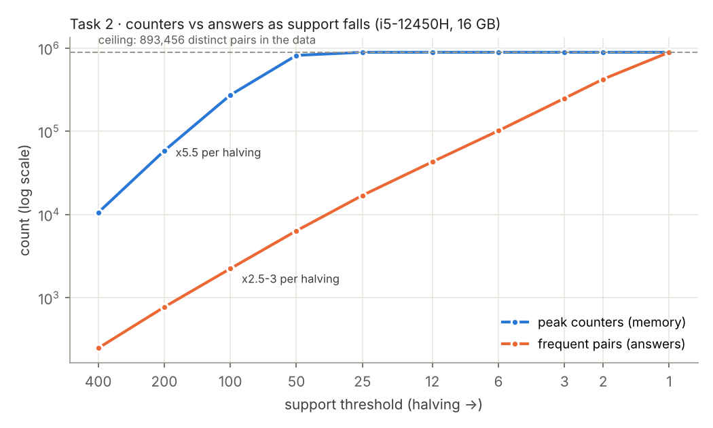

# Task 2 · 임계값을 낮추다 보면 어디서 터지는가

## A6 · 측정 환경
- CPU: Intel Core i5-12450H (Alder Lake, `Intel64 Family 6 Model 154 Stepping 3`)
- RAM: 16 GB
- OS / Python: Windows 11 (`Windows-10-10.0.26200-SP0`), Python 3.11.2
- 메모리: 실행 전 시스템 전체 사용량이 이미 약 10 GB였다(16 GB 중, 다른 프로그램들). 측정하는 동안에는 약 300 MB만 더 늘었다(작업 관리자 성능 탭).
- 같이 실행 중이던 프로그램: Claude 데스크톱 앱, PowerShell, 작업 관리자

## A1 · A3 · support에 따른 카운터와 답

`python task2_explosion.py --supports 400,200,100,50,25,12,6,3,2,1`로 측정했다(바구니 20,000개, 상품 2,000개). 측정 조건은 다음과 같다.

- 메모리는 tracemalloc이 기록한 최대값(파이썬이 할당한 양)이고, MB = 10⁶ 바이트다.
- tracemalloc을 켠 상태라 실제보다 느리다.
- support 범위는 400배다(A1의 16배 조건 충족).

| support | 빈발 쌍(답) | 최대 카운터 | 카운터 / 답 | 시간 | 최대 메모리 |
|---:|---:|---:|---:|---:|---:|
| 400 | 249 | 10,585 | 42.5 | 1.28 s | 1.1 MB |
| 200 | 776 | 58,626 | 75.5 | 2.19 s | 6.4 MB |
| 100 | 2,244 | 273,701 | 122.0 | 2.75 s | 26.5 MB |
| 50 | 6,397 | 820,259 | 128.2 | 4.83 s | 102.4 MB |
| 25 | 17,045 | 893,456 | 52.4 | 5.88 s | 102.4 MB |
| 12 | 43,116 | 893,456 | 20.7 | 6.05 s | 102.7 MB |
| 6 | 101,938 | 893,456 | 8.8 | 6.25 s | 119.4 MB |
| 3 | 250,054 | 893,456 | 3.6 | 6.66 s | 156.6 MB |
| 2 | 424,620 | 893,456 | 2.1 | 7.11 s | 204.8 MB |
| 1 | 893,456 | 893,456 | 1.0 | 7.99 s | 327.0 MB |

## A2 · 불편해진 지점과 먼저 바닥난 것

**support 1까지 내려도 견딜 수 없어지지 않았다. 아무것도 바닥나지 않았다.** 가장 무거운 support 1에서도 8초, tracemalloc 기준 327 MB였다. 작업 관리자에서도 실행 전 약 10 GB였던 시스템 전체 사용량이 약 300 MB 늘어나는 데 그쳤다. 이 값은 tracemalloc의 327 MB와 거의 같다. 4주차에는 set의 실제 메모리가 tracemalloc 값의 약 4배였는데, 이번에는 tracemalloc이 실제 사용량을 잘 반영했다.

터지지 않은 이유는 내 노트북이 아니라 데이터에 있다. support 25에서 상품 2,000개가 **모두** 빈발이 되었고, 그 뒤로 카운터는 이 데이터에 실제로 나타나는 서로 다른 쌍의 수인 **893,456**에서 멈췄다. 이론적 상한 C(2000, 2) = 1,999,000의 45%다. 카운터가 늘 수 없으니 메모리도 늘 수 없다. support 25 → 1에서 tracemalloc이 102 → 327 MB로 늘어난 것은 카운터 때문이 아니다. 카운터를 다 센 뒤 결과로 만드는 빈발 쌍 딕셔너리(17,045 → 893,456개)가 카운터와 동시에 메모리에 있기 때문으로 보인다(코드 구조에서 추론, 따로 측정하지 않음).

같은 곡선이 상한 없이 이어졌다면 어땠을지 계산해 보았다. support 400 → 50 구간처럼 반으로 낮출 때마다 카운터가 약 5배씩 늘었다면, 25에서 약 400만, 12에서 약 2,000만, 6에서 약 1억 개다. Python의 쌍 딕셔너리는 tracemalloc 기준 카운터당 약 125 B(102.4 MB / 820,259)이므로, 1억 개면 약 13 GB가 되어 이 노트북의 16 GB를 넘는다. 즉 상품이 2,000개가 아니라 수만 개였다면 **support 6 근처에서 메모리가 먼저 바닥났을 것**이다(외삽, 측정 아님).

## A4 · 카운터 증가율

반으로 낮출 때마다 카운터는 **×5.54(400 → 200), ×4.67(200 → 100), ×3.00(100 → 50)** 이었다. 두 배보다 훨씬 나쁘다. 그 뒤로는 상한에 막혀 ×1.09, ×1.00이다.

이유는 상품 인기도가 Zipf 분포(가중치 1/i^0.8)라는 데 있다.

- support ≥ s인 상품 수 k는 s^(−1/0.8)에 비례한다. 반으로 낮추면 k가 2^1.25 ≈ 2.38배가 된다. 실측은 146 → 345 → 825 → 1,849로 ×2.36, ×2.39, ×2.24였다.
- A-Priori의 카운터는 빈발 상품끼리의 쌍이라 ≈ k²에 비례하므로, 반으로 낮출 때마다 2.38² ≈ **5.66배**가 된다.
- 첫 구간 ×5.54는 이 예측과 맞는다. 그 뒤로 줄어드는 것은 상품이 늘수록 "같은 바구니에 한 번도 같이 안 나온 쌍"이 많아져서, 카운터가 k²보다 덜 늘기 때문이다. 결국 상한에서 멈춘다.

## A5 · 답의 증가는 카운터와 다르다

빈발 쌍(답)은 반으로 낮출 때마다 ×3.12, ×2.89, ×2.85, ×2.66, ×2.53, ×2.36…으로 **꾸준히 약 2.5~3배** 늘었다. 카운터와 달리 상한에 막히지 않고 support 1까지 계속 올라가서, 마지막에 카운터와 같아진다.

- 카운터는 "두 상품이 각각 흔한" 모든 쌍이고, 답은 그중 "실제로 s번 이상 같이 나온" 쌍이다. 두 상품이 각각 흔해도 같이 나오는 것은 훨씬 드물다. 그래서 상한에 닿기 전까지는 카운터가 답보다 훨씬 빨리 는다.
- 그 결과 답 하나를 찾는 데 드는 카운터가 support 400에서 42.5개, 50에서 **128개**로 3배가 되었다.
- "임계값을 조금만 낮추자"는 요청은 답이 3배가 되는 대가로 메모리가 5배가 되는 요청이다. 이 간격(카운터 ≫ 답)을 줄이는 것이 §6.3(PCY)의 목적이다. 같은 support 50에서 PCY는 카운터를 14,337개로 줄여, 답 하나당 2.2개까지 내렸다(Task 3).
