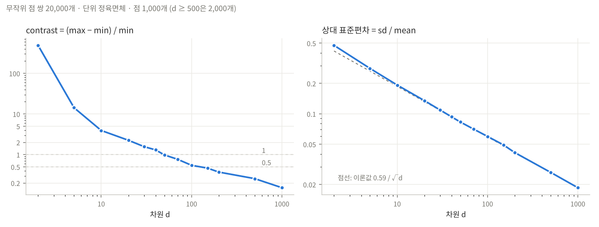

# Task 2 · 거리가 의미를 잃는 차원



## A7 · 측정 환경
- 노트북: Intel Core i5-12450H (6주차와 같은 노트북)
- 실행 위치: 그 노트북의 Claude 데스크톱 앱이 띄운 Linux VM (Ubuntu 22.04, 커널 6.8, vCPU 2개, RAM 4 GB). `curse.json`의 `platform`이 Linux인 이유다.
- Python 3.10.12
- 가장 큰 실행: d = 1000, 점 2,000개 → **2.39초**. 쌍 수를 20만으로 늘린 d = 50 실행은 1.58초. 전체 측정은 10초 안에 끝났다.

## A1 · A2 · 차원별 대비 (점 1,000개, 무작위 쌍 20,000개)

```
python3 task2_curse.py --dims 2,5,10,20,50,100,200
python3 task2_curse.py --dims 30,40,70,150
python3 task2_curse.py --dims 500,1000 --points 2000
```

| d | min | max | mean | √(d/6) | contrast | rel. sd | 0.59/√d |
|---:|---:|---:|---:|---:|---:|---:|---:|
| 2 | 0.003 | 1.326 | 0.521 | 0.577 | **488.6** | 0.476 | 0.418 |
| 5 | 0.111 | 1.687 | 0.884 | 0.913 | 14.26 | 0.282 | 0.265 |
| 10 | 0.438 | 2.159 | 1.274 | 1.291 | 3.93 | 0.193 | 0.187 |
| 20 | 0.821 | 2.670 | 1.815 | 1.826 | 2.25 | 0.135 | 0.132 |
| 30 | 1.220 | 3.126 | 2.228 | 2.236 | 1.56 | 0.109 | 0.108 |
| 40 | 1.545 | 3.566 | 2.575 | 2.582 | 1.31 | 0.093 | 0.094 |
| 50 | 1.909 | 3.785 | 2.867 | 2.887 | **0.98** | 0.083 | 0.084 |
| 70 | 2.465 | 4.357 | 3.397 | 3.416 | 0.77 | 0.071 | 0.071 |
| 100 | 3.206 | 4.954 | 4.068 | 4.082 | 0.55 | 0.060 | 0.059 |
| 150 | 4.064 | 5.955 | 4.990 | 5.000 | **0.47** | 0.049 | 0.048 |
| 200 | 4.871 | 6.682 | 5.776 | 5.774 | 0.37 | 0.041 | 0.042 |
| 500* | 8.099 | 10.176 | 9.126 | 9.129 | 0.26 | 0.026 | 0.026 |
| 1000* | 11.970 | 13.806 | 12.909 | 12.910 | **0.15** | 0.019 | 0.019 |

\* 점 2,000개. contrast = (max − min) / min.

## A3 · contrast는 어떻게 되는가
- d = 2에서 488이던 대비가 d = 1000에서 0.15가 된다. 2차원에서는 가장 먼 쌍이 가장 가까운 쌍보다 489배 멀지만, 1000차원에서는 **15%** 더 멀 뿐이다.
- **1 아래로 떨어지는 곳은 d ≈ 50** (d = 40에서 1.31, d = 50에서 0.98). "가장 먼 쌍이 가장 가까운 쌍의 두 배도 안 된다"는 뜻이다.
- **0.5 아래는 d ≈ 120** (d = 100에서 0.55, d = 150에서 0.47, 로그 보간하면 약 124).
- 감소는 처음에 급하고(2 → 10에서 100배 넘게) 이후 완만하다. 큰 d에서는 대략 1/√d로 줄어든다(200 → 1000, 5배에 0.37 → 0.15, √5 ≈ 2.2배).

## A4 · 평균 거리는 √d로 자란다
- 좌표 하나의 차이 (x − y)²의 기댓값은 1/6이다(x, y ~ U(0,1)). 그래서 거리² 의 기댓값은 d/6이고, **평균 거리 ≈ √(d/6)**이다. 선형이 아니라 제곱근이다.
- 측정과 비교하면 d ≥ 10에서 0.5% 안으로 맞는다(d = 1000: 12.909 vs 12.910).
- d = 2(0.521 vs 0.577)와 d = 5에서는 측정값이 작다. 측정이 틀린 것이 아니라 **E[√X] ≤ √E[X]** (Jensen 부등식) 때문이다. 퍼짐이 클수록 차이가 크고, d가 커져 퍼짐이 줄면 사라진다. 실제로 단위 정사각형의 평균 거리 정확값은 0.5214로, 측정값 0.521과 같다.

## A5 · 상대 표준편차
- rel. sd = sd / mean도 0.476 → 0.019로 떨어지고, 이론값 **0.59/√d**에 d ≥ 10부터 거의 정확히 붙는다(거리² 은 독립 항 d개의 합이라 상대 퍼짐이 1/√d로 준다).
- 둘 중 **rel. sd가 "거리가 의미를 잃었다"를 더 잘 나타낸다.** rel. sd는 분포 전체의 폭이라 d만으로 정해지고 점·쌍 수와 무관하다(A6에서 n을 바꿔도 0.081~0.084). contrast는 가장 극단적인 두 쌍(min, max)으로 정해져서 **몇 쌍을 봤는지**에 따라 값이 바뀐다.
- 다만 최근접 이웃 검색이 실제로 겪는 것은 contrast 쪽이다. "가장 가까운 것"과 "가장 먼 것"의 차이가 검색 결과의 의미이기 때문이다. 그래서 둘을 같이 보고, **차원의 효과는 rel. sd로, 내 데이터 크기에서의 체감은 contrast로** 읽는 것이 맞다.

## A6 · contrast는 n에도 달려 있다 (d = 50 고정)

| 점 n | 서로 다른 쌍(최대) | 뽑은 쌍 | contrast | rel. sd |
|---:|---:|---:|---:|---:|
| 20 | 190 | 19,006 | 0.58 | 0.084 |
| 100 | 4,950 | 19,798 | 0.81 | 0.081 |
| 1,000 | 499,500 | 19,977 | 0.98 | 0.083 |
| 10,000 | 5천만 | 20,000 | 1.05 | 0.084 |
| 50,000 | 12억 | 19,999 | 1.13 | 0.084 |
| 10,000 | 5천만 | **199,977** | **1.38** | 0.084 |

- **n이 클수록 contrast가 커진다.** 점이 20개면 서로 다른 쌍이 190개뿐이라 20,000번 뽑아도 같은 쌍만 반복되고, 극단값(min, max)이 평균에서 멀리 나가지 못한다.
- 결정적인 것은 실제로 비교한 **서로 다른 쌍의 수 m**이다. 같은 n = 10,000에서 쌍을 20,000 → 200,000으로 늘리면 1.05 → 1.38이 된다. 분포의 꼬리를 더 많이 보면 min은 더 작게, max는 더 크게 나온다(극단값은 대략 평균 ± √(2 ln m)·sd).
- 의미: "contrast < 1이 되는 차원"은 데이터 크기의 함수다. 점 1,000개·쌍 2만 개에서는 d ≈ 50이었지만, 모든 쌍을 비교하는 실제 검색(점 10,000개면 5천만 쌍)에서는 같은 d에서 대비가 더 크고 경계 차원도 더 올라간다. 반대로 rel. sd는 n과 무관하므로, **차원의 저주 자체는 d의 성질이고, 그것이 얼마나 아픈지는 n이 정한다.**

## A8 · 3주차 LSH(Jaccard)를 위협하는가?
**위협하지 않는다.** 이유는 세 가지다.

1. **측정한 가정이 성립하지 않는다.** 위 결과는 좌표가 서로 독립이고 균등분포인 점에서 나왔다. shingle 집합은 차원(가능한 shingle 수)은 엄청나게 크지만 매우 희소하고, 비슷한 문서는 같은 shingle을 실제로 공유한다. 데이터에 구조가 있으면 "거의 모든 쌍이 같은 거리"가 되지 않는다.
2. **집중은 오히려 무관한 쌍 쪽에서 일어난다.** 무작위 문서 쌍의 Jaccard 유사도는 0 근처(거리 ≈ 1)에 몰린다. 이것이 Jaccard 공간에서 보이는 차원의 저주인데, LSH가 찾는 것은 그 덩어리 안의 순위가 아니라 **덩어리에서 멀리 떨어진 소수의 쌍**(유사도 0.8 같은 near-duplicate)이다. 배경이 한 점에 몰릴수록 S-곡선이 그것을 걸러 내기 쉽고 false positive도 줄어든다.
3. **LSH는 원래 공간의 거리를 직접 재지 않는다.** MinHash 서명 한 칸이 일치할 확률이 정확히 Jaccard 유사도이고, 이 성질은 차원 수와 무관하다. 서명 길이(밴드 b × 행 r)는 원하는 임계값으로 정하지 차원으로 정하지 않는다.

단, **위협이 되는 경우도 있다.** "비슷한" 쌍이 무작위 쌍보다 아주 조금만 더 가까운 데이터(예: 구조가 약한 고차원 밀집 벡터에서 k-최근접 이웃을 찾는 경우)라면, 가까운 쌍과 먼 쌍의 유사도 차이가 작아 S-곡선이 둘을 가를 수 없다. 이때는 LSH도, k-means도 먼저 차원을 줄이거나(PCA/SVD, 12주차) 다른 거리를 골라야 한다.
